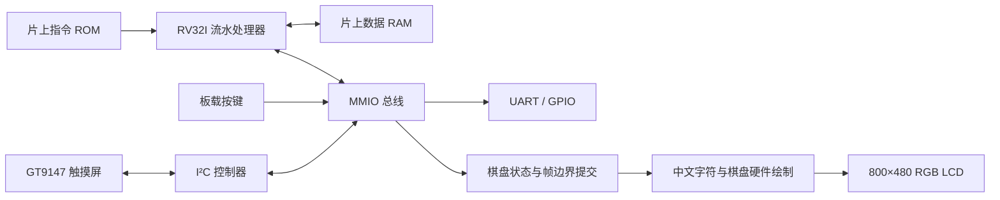
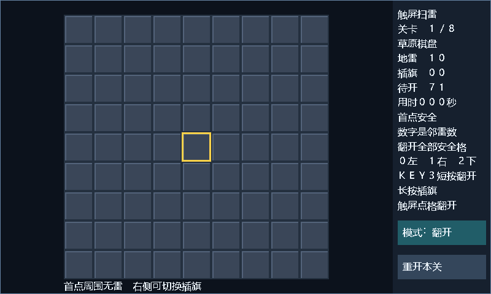

# RISC-V 处理器与触屏扫雷系统

面向 2026 全国大学生嵌入式芯片与系统设计竞赛 FPGA 创新设计赛道，采用 SystemVerilog 实现可配置 RV32I 处理器，并在正点原子 ATK-L50（PGL25G-6/MBG324）完成 CoreMark 测试与中文触屏扫雷演示。

**实板 CoreMark：125.57618，CoreMark/MHz：5.023047。** 测试运行 2000 次迭代，持续 15.92658788 秒，性能种子与三个算法 CRC 全部通过。触屏扫雷支持 8 个关卡、变化地图及递增难度，已完成 SRAM 下载回读、串口启动和实物交互验收。

[作品说明书](docs/参赛作品说明书.md) · [性能分析](docs/性能分析报告.md) · [演示操作](docs/演示操作指南.md) · [提交材料清单](docs/提交材料清单.md) · [证据索引](docs/evidence/2026-11-04/results.json)

## 实现与验证结果

| 项目 | CoreMark 性能配置 | 触屏扫雷配置 |
|---|---|---|
| CPU | RV32I + Zmmul + Zba/Zbb，双发射 | RV32I，单发射 |
| 工作时钟 | 25 MHz，50 MHz 输入实际二分频 | 50 MHz |
| 存储器 | 64 KiB 指令 ROM、8 KiB 数据 RAM | 64 KiB 指令 ROM、16 KiB 数据 RAM |
| 关键参数 | BTB16、两拍乘法、快速数据 RAM | 同步存储、GT9147 触摸、RGB LCD |
| LUT / FF / DRM | 11864 / 2783 / 32 | 5338 / 4109 / 42 |
| 布线后 setup WNS | +2.932 ns | +1.015 ns |
| 实板结果 | 125.57618 CoreMark，5.023047/MHz | 中文界面、触摸与按键操作正常 |

两套配置使用同一处理器与 SoC 源码，分别构建性能镜像和应用镜像。时序、资源及实测分数分别绑定对应镜像，不能跨配置混用。[性能原始报告](docs/evidence/2026-11-04/coremark/capture.txt)、[评分结果](docs/evidence/2026-11-04/coremark/score.json)、[应用验收](docs/evidence/2026-11-04/mine/operator_acceptance.json)及[发布文件](releases/2026-11-04/)均提供校验信息。

## 系统结构



处理器采用连续取指、数据前递和动态分支预测；性能配置增加标准乘法与位操作扩展、相邻指令双发射。扫雷规则、布雷和交互状态由 CPU 执行，FPGA 根据棋盘状态生成像素，在帧边界提交完整画面。

## 应用预览



图像由实际 LCD 渲染 RTL 逐像素生成。实物显示和操作验收记录见[应用证据目录](docs/evidence/2026-11-04/mine/)。

- 9×9 棋盘，8 关雷数依次为 10、12、14、16、18、20、22、24。
- 四种障碍地形轮换；首次开启格及相邻区域无雷。
- 支持触屏开格、模式切换插旗、按键移动、短按开格和长按插旗。
- 失败显示地雷与错旗；完成关卡后进入下一关，第 8 关后循环。

## 目录与复现

| 路径 | 内容 |
|---|---|
| [rtl](rtl/) | CPU、SoC、时钟复位、UART、I²C、触摸与 LCD |
| [software](software/) | 裸机启动、CoreMark 移植、扫雷固件 |
| [sim](sim/) | 指令、总线、板级时钟与扫雷仿真 |
| [scripts](scripts/) | 构建、验证、评分及下载工具 |
| [constraints](constraints/) / [boards](boards/) | PGL25G 引脚、时序与 PDS 工程配置 |
| [releases/2026-11-04](releases/2026-11-04/) | 两套实板镜像、固件和 SHA256 清单 |
| [docs/evidence/2026-11-04](docs/evidence/2026-11-04/) | 原始串口、下载记录、资源时序与仿真证据 |

环境：Python、PowerShell、Icarus Verilog；固件构建使用 WSL Ubuntu 中的 RISC-V GCC 14.2.0；硬件实现使用 Pango Design Suite 2022.2-SP4.2。

```powershell
# 指令与应用验证
python scripts/run_isa_checks.py --zmmul --bitmanip --dual --mul-cycles 2 --decode-pipeline 0
python scripts/run_board_clock_checks.py
python scripts/run_mine_checks.py

# 按实际频率复核已归档的板测分数
python scripts/coremark_score.py --capture docs/evidence/2026-11-04/coremark/capture.txt --clock-hz 25000000 --lut-count 11864 --evidence-kind BoardCapture --output-dir build/score_recheck
```

完整构建与实物演示步骤见[演示操作指南](docs/演示操作指南.md)。

## 实现范围

支持 RV32I 基础整数执行及可配置 Zmmul、Zba、Zbb；非法指令、未对齐访问等进入停机状态。未提供完整特权 CSR、可恢复异常/中断、指令/数据 Cache 或 AI 加速单元。已有硬件 ILA 记录用于早期 CPU 基线分析，双发射版本的流水分析另见功能仿真与周期统计。

原创代码采用 [MIT License](LICENSE)；CoreMark 适用其[单独许可](software/coremark/LICENSE.md)。
