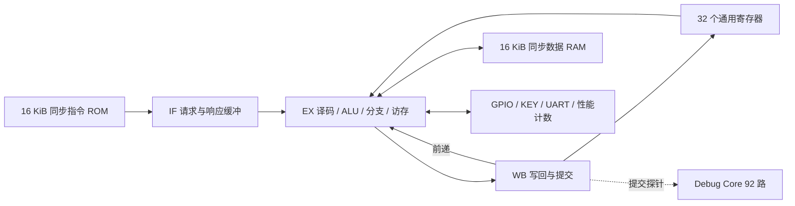

# 基于紫光同创 FPGA 的 RV32I 三级流水处理器与性能分析平台

版本：2026-11-01，实板验收终版。所有数据均为在 ATK-L50（PGL25G/-6/MBG324）上的实测结果，
证据文件路径见各节。离线版（2026-10-28）只保留历史价值。

## 作品目标与赛题对应

面向全国大学生嵌入式芯片与系统设计竞赛 2026 FPGA 创新设计赛道、紫光同创选题一。
设计采用 SystemVerilog，实现 RV32I 整数处理器、三级流水线、片上同步存储器、UART/GPIO、
只读按键端口与 64 位性能计数器；配套裸机固件、CoreMark 跑分与硬件 ILA 波形采集。

| 赛题要求 | 交付内容 | 实板证据 |
|---|---|---|
| RV32I 处理单元 | 算术逻辑、立即数、访存、分支、跳转、FENCE | 48 次逐条指令差分（7455 条提交）仿真；不是官方架构认证 |
| 不少于三级流水 | IF/EX/WB，前递、访存等待、控制转移排空 | 逐条提交检查 + 同步存储延迟压力测试 |
| UART/GPIO | UART TX、8 位 GPIO（4 灯）、4 位只读 KEY | COM8 实板串口 115200 8N1 全流程验证 |
| CoreMark | 裸机移植、软件乘除法、双镜像、CRC 检查 | **300 迭代 / 17.834 s / 16.822 分 / 0.3364 CoreMark/MHz，CRC `0x5275` 正确** |
| 性能分析 | 64 位周期/提交计数、PDS 资源时序报告、硬件 ILA 波形 | **92 路探针 / 512 点深度，抓到 `matrix_mul_matrix_bitextract` 与 `__mulsi3` 内循环** |
| 实际应用 | 反应力小游戏（随机点灯 + 按键反应计时） | 10 轮完整一局串口输出；仿真覆盖按键 OK / 按错 / 超时三分支 |

## 系统结构



取指端采用 valid/ready 接受请求，rvalid 返回已注册的数据；发生跳转时已接受的错误路径取指会被排空，
不能直接取消外部未完成请求。EX 等待数据访存完成时保持请求稳定，WB 完成一次后清空，避免同一指令
被重复计数；WB 到 EX 前递处理相邻数据依赖。

提交接口输出 PC、原始指令、目标寄存器和写回数据，离线差分验证直接比较这些接口，不以"最后亮灯"
代替指令验证。

## 地址空间与运行环境

| 地址 | 功能 |
|---|---|
| 指令地址 0x00000000–0x00003fff | 16 KiB 指令 ROM |
| 数据地址 0x00000000–0x00003fff | 数据 RAM 低地址别名 |
| 0x20000000–0x20003fff | 指令 ROM 只读数据别名（启动复制用） |
| 0x40000000–0x40003fff | 数据 RAM 链接地址别名 |
| 0x10000000 | GPIO 输出 / 读回，低 4 位驱动 LED0–3 |
| 0x10000004 | UART 发送，读 bit0 为 ready |
| **0x10000008** | **KEY0–KEY3 只读，低有效，全松开读到 0xF** |
| 0x10000010 / 14 | 周期计数低/高 32 位 |
| 0x10000018 / 1c | 提交指令计数低/高 32 位 |
| 0x10000020 | 配置的时钟频率（非实测值） |

软件采用 RV32I/ILP32、裸机、无 libc。`start.S` 设栈、从 ROM 别名复制 `.data`、清 `.bss` 后进 C `main`；
链接脚本保留 1 KiB 栈并检查数据区重叠。CoreMark 的乘除法由软件例程完成，不依赖 M 扩展。

## 实测结果

### CoreMark（2026-11-01）

```
2K performance run parameters for coremark.
CoreMark Size    : 666
Total ticks      : 891700236
Total time (secs): 17
Iterations/Sec   : 17
Iterations       : 300
seedcrc          : 0xe9f5
[0]crclist       : 0xe714
[0]crcmatrix     : 0x1fd7
[0]crcstate      : 0x8e3a
[0]crcfinal      : 0x5275
Correct operation validated.
```

| 指标 | 值 |
|---|---|
| 主频 | 50 MHz |
| 迭代 / 用时 | 300 / 17.834 s |
| CoreMark 分数 | **16.822** |
| CoreMark/MHz | **0.3364** |
| 逻辑资源 | 1826 LUT |
| 判定 | `verdict=PASS`、`publishable=true` |

证据：`fpga_riscv_starter/build/uart_capture/coremark_board_20261101_01/`（`capture.txt`、`coremark_score.json`、
`program_result.json`）。

### 硬件 ILA 波形（2026-11-01）

- 在 PGL25G 内实例化 Debug Core，92 路探针接入核心提交接口（`commit_pc[31:0]`、`commit_instr[31:0]`、
  12 个单比特控制信号、`cycle_low[7:0]`、`retire_low[7:0]`），512 点采样深度，记录 CoreMark 执行片段。
- 解码结果：149 次提交、17 个不同 PC。主要片段是 `matrix_mul_matrix_bitextract`（`0x1668`）经 `jalr`
  调用软件 `__mulsi3`，其位置加法循环 `0x2c34–0x2c4c` 连续执行 20 轮，与 32 位乘法的移位相加结构一致。
- 证据：`fpga_riscv_starter/build/coremark_ila/`（波形文本、FIC、位流摘要、解码脚本），
  说明见 [ILA 波形采集](2026-11-01_ILA波形采集.md)。

### 反应力小游戏（实际应用演示）

规则、地址映射、两个 bug 的修复过程与完整串口输出见 [反应力游戏](2026-11-01_反应力游戏.md)。
要点：

- 新增唯一一根输入通路：`0x10000008` 只读 KEY，`key[0..3] = V12/T12/N9/M10`，3.3 V/LVCMOS12。
- 仿真回归 `tb_game`：`[PASS] reflex_game captured 351 UART bytes in 1457208 cycles, Match 1/2 (one OK, one WRONG KEY)`。
- 上板：10 轮全部跑完、开机自检读到 `0x0000000F`、按 KEY 后串口输出 `OK <n> ms`。
- 该演示把"流水线 CPU + MMIO + 中断无关的裸机软件 + 串口人机交互"串成一条可复现的实物演示链路。

### 资源与时序（游戏镜像）

| 项目 | 数值 |
|---|---|
| LUT | 1840 / 22560（8.16%） |
| 寄存器 | 1395 / 33840（4.12%） |
| 时序约束 | 20 ns（50 MHz） |
| 最差 setup slack | +2.531 ns（TNS 0），即 50 MHz 有约 12.7% 余量 |
| 保持时间 | 无违例 |

> 外部异步复位与 LED/UART 接口延迟未纳入预算（`release.json` 的 `timing_scope` 已注明）。

## 已实现的停机策略与限制

EBREAK 正常停机；非法指令和未对齐访问触发 trap 停机，故障指令不产生访存或寄存器写回副作用。
ECALL 也进入 trap 停机，没有 mcause/mepc/mtvec、MRET 或可恢复中断入口，因此**不宣称**已实现完整
异常/中断或完整特权架构。FENCE 在当前无 Cache、单核、顺序完成数据事务的系统中按 NOP 执行。
未实现 CSR、M/C 扩展、Cache、BTB、DDR 控制器和 AI 加速器。

## 评审口径与板卡合规性

赛道答疑明确的评审顺序是：**先评审作品基于场景的特性指标；同等指标下再比较该场景下的逻辑资源与时序表现；同等条件下，最后才是 CPU 性能（CoreMark 等）**。本说明书的章节顺序与之一致：先给反应力小游戏的交互实测，再给资源与时序，最后给 CoreMark 跑分。

板卡方面，答疑说明推荐板卡的逻辑资源区间为 50k–200k LUT；本作品使用正点原子 ATK-L50（PGL25G，22 560 LUT），属**非推荐板卡**。按答疑"非推荐板卡需提供清晰资源说明与相应证明数据、确保不超过推荐板卡性能"的要求，此处给出完整占用：LUT 1 840 / 22 560（8.16%）、FF 1 395 / 33 840（4.12%）、DRM18K 16 / 60（26.67%）、时序 slack +2.531 ns（game 版）与 +1.579 ns（CoreMark 版）。三项占用均远低于推荐板卡规模，不存在"用小板换分数"的问题。

## 可复现流程

```powershell
# 1. 固件（WSL 中的 riscv64-unknown-elf-gcc）
scripts/build_firmware.ps1 -App all

# 2. 仿真回归（15 项，含 CoreMark 与 reflex game）
scripts/run_iverilog.ps1

# 3. 位流（含可选 ILA）
scripts/run_pds.ps1 -Target cpu -FirmwareApp coremark -ConstraintProfile Vcc33 -Stage Bitstream
scripts/build_coremark_ila.ps1

# 4. 下载与采集（CLI：Shutdown 模式 + 非 ISC 回读 + GOUTEN 校验）
scripts/program_sram.ps1 -Target cpu -FirmwareApp coremark
scripts/capture_uart.ps1 -Port COM8 -TimeoutSeconds 90 -CompletionMarker 'Correct operation validated'
scripts/run_game_capture.ps1 -Port COM8 -TimeoutSeconds 150
```

发布包：`build/board_release/cpu/{coremark,perf_report,game}/atk_l50_top.sbit`。

## 边界与未做项

- CoreMark 分数基于 300 次迭代的 17.8 s 运行，满足 EEMBC 十秒规则；未做多日重复性统计。
- ILA 只抓了 512 点、单次触发，用于展示乘法内循环，不是完整指令追踪。
- Flash 冷启动未验收，全部验证走 SRAM 下载。
- 演示的高分纪录依赖人工按键（反应时间含人的操作），只做功能演示，不作为性能指标。