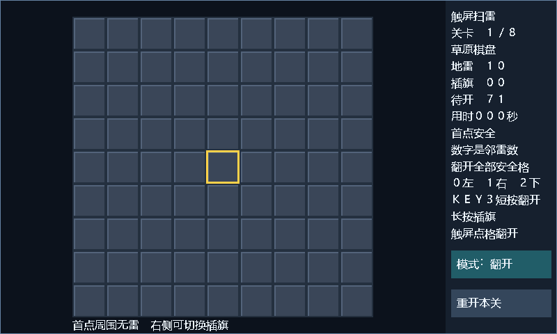

# 参赛作品说明书

作品名称：**RISC-V 处理器与触屏扫雷系统**  
赛道：2026 全国大学生嵌入式芯片与系统设计竞赛 FPGA 创新设计赛道，紫光同创选题一  
硬件平台：正点原子 ATK-L50，PGL25G-6/MBG324  
验证日期：2026-11-04

## 1. 作品概述

本作品以自研 SystemVerilog RISC-V 处理器为核心，构建裸机计算与触摸交互系统。处理器支持 RV32I，并提供标准乘法、位操作、动态分支预测和双发射配置。性能镜像在实际 25 MHz 下完成 CoreMark 2000 次迭代，取得 **125.57618 CoreMark、5.023047 CoreMark/MHz**；应用镜像在 50 MHz 下运行中文触屏扫雷，完成显示、触摸、按键及串口实物验证。

系统把计算与显示任务分开：CPU 执行游戏规则、布雷、邻雷计数、连锁展开和输入处理；FPGA 渲染棋盘、光标与中文状态栏。无需逐像素软件绘制，画面通过帧边界提交保持一致。

## 2. 赛题功能对应

| 功能 | 实现 |
|---|---|
| RV32I 通用处理单元 | 寄存器堆、整数 ALU、跳转、访存与基础停机策略 |
| 不少于三级流水 | IF / EX / WB；可选独立译码级 |
| 数据冲突处理 | 写回前递、双写回优先级、首槽向第二槽前递、等待互锁 |
| 控制冲突处理 | 带标签 BTB、条件预测计数器、重定向及过期取指响应排空 |
| 基础外设 | UART TX、GPIO、板载按键、64 位周期与退休计数器 |
| 动态分支预测 | 两个相邻 PC 的查询与训练，支持双发射取指包 |
| 标准指令扩展 | Zmmul、Zba、Zbb，可按配置开启 |
| 应用场景 | 800×480 中文触屏扫雷，8 关地图与递增难度 |

完整特权 CSR、可恢复异常/中断、两路组相联指令/数据 Cache 和 AI 加速不在本实现范围内。

## 3. 处理器结构

### 3.1 流水与存储

核心采用连续同步取指，保留一个在途请求与响应缓冲。遇到数据等待时保持请求内容稳定；分支重定向后丢弃旧路径响应，避免重复执行或错误路径提交。

指令 ROM 与数据 RAM 分离。性能配置使用 64 KiB 指令 ROM，按偶、奇地址分银行，单拍提供相邻两条指令；数据 RAM 为 8 KiB 异步读、同步字节写。应用配置使用 16 KiB 同步数据 RAM。启动代码从 ROM 数据别名复制初始化数据，再清零 BSS。

### 3.2 双发射与标准扩展

双发射配置使用四读口、双写口寄存器堆。第一槽保留完整执行能力；第二槽执行普通 ALU 和分支/JAL/JALR，访存、乘法或异常指令串行转到第一槽。第二槽自身预测失败时仍正常退休，并清除之后的错误路径。首槽跳转或异常不允许年轻指令越过提交。

Zmmul 实现 MUL、MULH、MULHSU、MULHU，性能镜像采用两拍乘法。Zba 提供移位加法，Zbb 提供逻辑取反、计数、大小比较、扩展、旋转及字节处理。指令编码检查区分保留编码与 RV64 编码。

### 3.3 时钟与复位

性能镜像由板载 50 MHz 输入实际二分频，经过全局时钟缓冲驱动 25 MHz CPU；时序约束同时描述 20 ns 输入时钟与 40 ns 派生时钟。源域和 CPU 域分别采用异步复位置位、两拍同步释放。UART、MMIO 频率常量及 CoreMark 固件常量均按 25 MHz 配置。

应用镜像直接使用 50 MHz 系统时钟，转发 25 MHz LCD 像素时钟。两种镜像的参数与资源分别记录在发布清单中。

## 4. SoC 地址接口

| 地址 | 用途 |
|---|---|
| `0x00000000` 起 | 指令 ROM |
| `0x20000000` 起 | ROM 的只读数据别名 |
| `0x40000000` 起 | 数据 RAM |
| `0x10000000` | GPIO / LED |
| `0x10000004` | UART TX 与 busy 状态 |
| `0x10000008` | KEY0–KEY3，低有效 |
| `0x10000010/14` | 64 位周期计数低/高字 |
| `0x10000018/1C` | 64 位退休指令计数低/高字 |
| `0x10000020` | 配置时钟频率 |
| `0x10000044` | 视频帧计数 |
| `0x10000054–60` | 触摸坐标、状态、事件与控制 |
| `0x100000A0–DC` | 扫雷棋盘与状态暂存区 |
| `0x100000E0` | 扫雷帧提交与 pending 状态 |

CPU 写完一组棋盘与状态后提交 E0，硬件在下一帧边界发布完整快照。固件等待 pending 清零后再编辑暂存区，避免屏幕读到半更新状态。

## 5. 中文触屏扫雷

棋盘为 9×9，共 8 个关卡。每关雷数为 `8 + 2×关卡号`，从 10 雷递增至 24 雷；四种障碍地形循环组合不同难度。首次开启格及相邻八格排除布雷，随后按邻雷数与连锁展开规则进行游戏。

触摸棋盘可开格；右侧按钮切换开格/插旗模式。KEY0 左移、KEY1 右移、KEY2 向下移动，KEY3 短按开格、长按插旗。失败后显示全部地雷、触雷位置和错旗；结果画面保留至明确重开操作，胜利后进入下一关。

图为实际渲染 RTL 输出。界面与交互已通过[实物验收](evidence/2026-11-04/mine/operator_acceptance.json)，完整八关逻辑由[集成仿真](evidence/2026-11-04/mine/simulation_integration.txt)覆盖。

## 6. 实测与验证

| 指标 | 性能镜像 | 扫雷镜像 |
|---|---:|---:|
| 实际系统时钟 | 25 MHz | 50 MHz |
| LUT | 11864 / 22560 | 5338 / 22560 |
| FF | 2783 / 33840 | 4109 / 33840 |
| DRM | 32 / 60 | 42 / 60 |
| setup WNS | +2.932 ns | +1.015 ns |
| SRAM 下载及回读 | 通过 | 通过 |
| 运行验证 | CoreMark CRC、完整报告 | 串口启动、屏幕与触摸操作 |

CoreMark 原始计数为 2000 次迭代、398164697 ticks，运行时间 15.92658788 秒。测试采用 GCC 14.2.0，主要选项为 `-O3 -flto -finline-limit=1000 -mrelax -march=rv32i_zba_zbb_zmmul`，完整选项见[构建输入](evidence/2026-11-04/coremark/build_inputs.json)。

处理器采用独立指令模型差分验证，双发射与扩展配置覆盖 135 次运行、55500 条提交、66 种指令行为。板级时钟测试覆盖实际分频、复位释放、UART 位宽、帧中复位和错误频率元数据负例。扫雷集成仿真覆盖真实 CPU、GT9147 I²C 模型、8 关切换与 1882 条断言。

详细数据、计算公式与证据口径见[性能分析报告](性能分析报告.md)。

## 7. 交付组成

源码、构建脚本、固件、位流与证据按[提交材料清单](提交材料清单.md)组织。两套位流位于 [releases/2026-11-04](../releases/2026-11-04/)，包含独立 SHA256 清单；原始运行、下载及资源时序证据位于 [docs/evidence/2026-11-04](evidence/2026-11-04/)。实物操作与复现方法见[演示操作指南](演示操作指南.md)。
