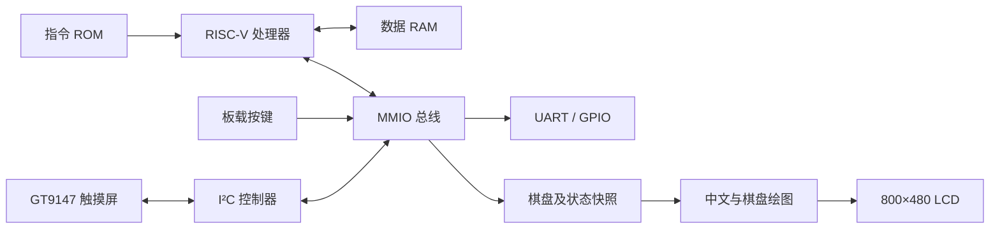
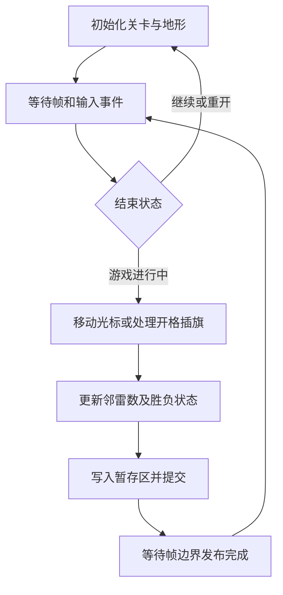
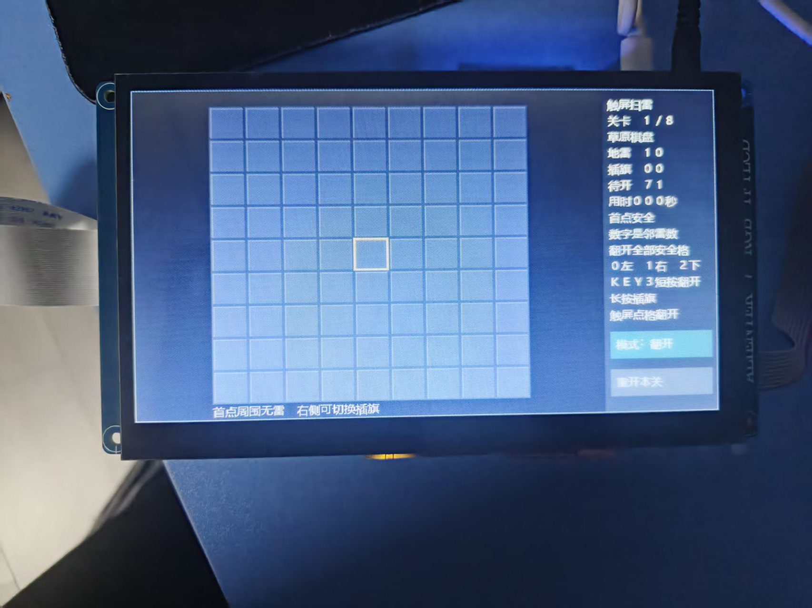
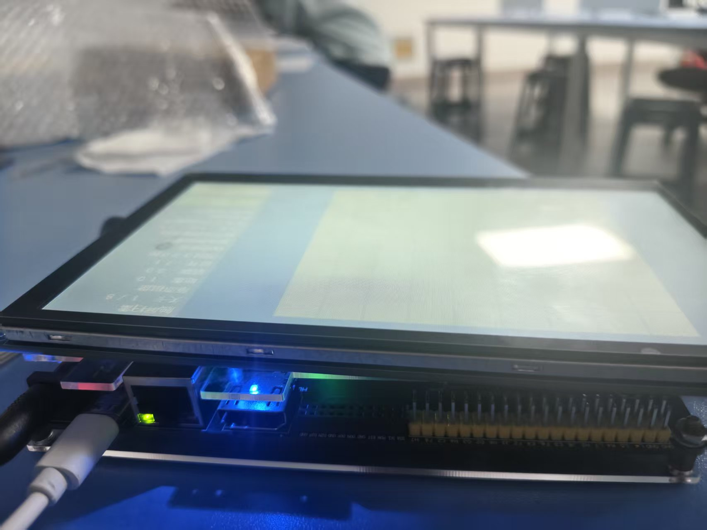
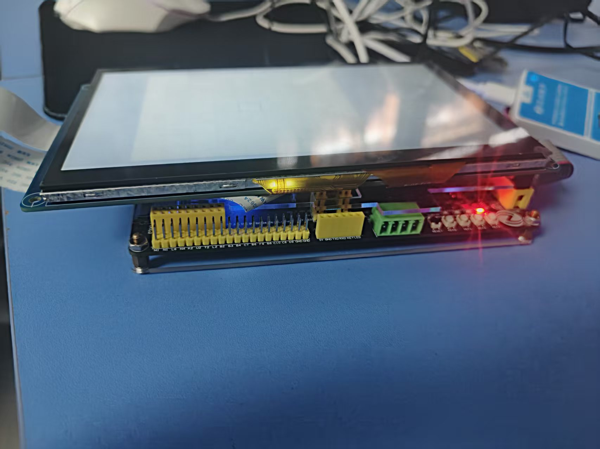

# 参赛作品说明书

作品名称：**RISC-V 处理器与触屏扫雷系统**  
赛道：2026 全国大学生嵌入式芯片与系统设计竞赛 FPGA 创新设计赛道，紫光同创选题一  
硬件平台：正点原子 ATK-L50，PGL25G-6/MBG324  
验证日期：2026-11-04  
关键词：**RISC-V、流水线优化、触屏扫雷**

## 摘要

本作品采用 SystemVerilog 设计可配置 RISC-V 处理器，在 FPGA 上实现裸机计算与触摸交互系统。处理器以 RV32I 为基础，采用流水执行、数据前递、动态分支预测，并提供 Zmmul、Zba/Zbb 标准扩展和相邻指令双发射。系统围绕可复核的执行周期、算法正确性、资源与布线后时序开展优化。

性能镜像在实际 25 MHz 下完成 CoreMark 2000 次迭代，计时 398164697 ticks，即 15.92658788 秒，取得 125.57618 CoreMark、5.023047 CoreMark/MHz；性能种子与算法 CRC 校验通过，使用 11864 LUT、2783 FF 和 32 DRM。应用镜像在 50 MHz 下运行中文触屏扫雷，支持 800×480 显示、GT9147 触摸、按键操作、8 个关卡、变化地形及递增雷数。CPU 执行游戏规则，FPGA 生成像素，并通过帧边界提交保持棋盘与状态栏一致。

作品完成两套镜像的 SRAM 下载回读、性能串口采集和应用实物交互验收，保留对应位流、固件、时序报告与原始证据。指令差分与真实 CPU 应用集成仿真进一步覆盖执行依赖、控制转移和八关逻辑。项目形成从处理器设计、软件编译到上板测量的完整实现流程。

## 第一部分 作品概述

### 1.1 功能与特性

系统提供可配置 RV32I 处理器、片上指令与数据存储、UART、GPIO、按键及计数器接口。性能配置支持标准乘法、位操作、动态分支预测和双发射，用于运行 CoreMark。应用配置连接 RGB LCD 与 GT9147 触摸屏，运行中文扫雷，支持开格、插旗、连锁展开、重开和关卡切换。8 关采用四种障碍地形，雷数从 10 递增至 24。首次开启格及相邻区域排除布雷，结束画面保持至明确的继续操作。

### 1.2 应用领域

作品适用于计算机组成、RISC-V 指令集、流水线优化和 FPGA 系统设计教学，可在同一平台观察软件编译、处理器执行和外设交互。性能配置用于研究执行周期、资源占用与工作频率的关系；触屏应用展示 CPU 规则处理与 FPGA 像素生成的分工。现有系统面向片上存储和裸机程序，适合作为小型交互终端与嵌入式实验平台的原型。

### 1.3 主要技术特点

处理器采用连续同步取指与响应缓冲，利用写回前递和等待互锁处理数据冲突；带标签 BTB 与方向计数器处理控制转移。双发射配置支持首槽向第二槽前递、双写回优先级和第二槽分支执行；不适合配对的指令按顺序串行执行。Zmmul 使用两拍乘法，Zba/Zbb 减少部分地址与位操作指令。

应用侧以 512 位棋盘及状态快照驱动硬件绘图，CPU 提交后在下一帧边界发布。性能与应用采用独立时钟配置，分别核对固件参数、资源、时序及运行证据。

### 1.4 主要性能指标

| 指标 | 结果 |
|---|---|
| CoreMark / MHz | 125.57618 / 5.023047 |
| 性能时钟 / 用时 | 25 MHz / 15.92659 s |
| 性能 LUT / FF / DRM | 11864 / 2783 / 32 |
| CPU / 应用 setup 余量 | +2.932 / +1.015 ns |
| 显示与关卡 | 800×480，8 关 |

### 1.5 主要创新点

1. 在紧凑流水结构中加入可配置双发射及第二槽控制转移，减少相邻指令串行执行。
2. 联合调整标准扩展、存储访问和编译参数，以周期、正确性及布线后时序共同评价优化。
3. 将扫雷规则与像素生成分离，采用帧边界快照提交，保持中文状态栏与棋盘一致。

### 1.6 设计流程

确定指令与接口范围，构建 RV32I 流水及基础外设；通过差分验证确认执行语义，使用 CoreMark 仿真分析瓶颈；逐步引入标准扩展、快速数据 RAM、双发射和分支优化；完成综合、布局布线及真实时钟配置；集成扫雷、触摸与显示，进行上板运行、下载回读和证据归档。

## 第二部分 系统组成及功能说明

### 2.1 整体介绍

系统由处理器、存储、MMIO 外设和显示交互模块组成。两套镜像复用处理器与 SoC 源码，性能镜像用于测量，应用镜像用于中文触屏扫雷。



CPU 通过存储映射接口读取输入、更新游戏状态和输出运行信息；显示模块根据快照生成 RGB 像素。性能配置的 LUT 数和工作频率只用于该配置的评分，不能与应用配置交叉使用。

### 2.2 硬件系统介绍

#### 2.2.1 硬件整体

开发板采用 PGL25G-6/MBG324，输入时钟 50 MHz。性能镜像使用寄存器实际二分频及全局时钟缓冲形成 25 MHz CPU 时钟，时序约束描述 20 ns 输入和 40 ns 生成时钟。源域与 CPU 域采用异步复位置位、两拍同步释放，UART 与计时频率常量保持一致。

应用镜像使用 50 MHz 系统时钟，向 LCD 转发 25 MHz 像素时钟。LCD 总时序为 1056×525，刷新率约 45.09 Hz。屏幕所在 Bank3 使用 3.3 V 配置。

| 配置 | 性能镜像 | 触屏扫雷镜像 |
|---|---|---|
| CPU | RV32I + Zmmul + Zba/Zbb，双发射 | RV32I，单发射 |
| 指令 ROM | 64 KiB，偶/奇分银行 | 64 KiB |
| 数据 RAM | 8 KiB，异步读、同步字节写 | 16 KiB，同步访问 |
| 主要参数 | BTB16、两拍乘法、快速数据 RAM | 同步存储、触摸与 LCD |
| 顶层 | `atk_l50_top` | `atk_l50_mine` |

#### 2.2.2 机械结构

作品采用开发板及配套 LCD 的现有结构，通过排线连接，未另行设计机械传动、外壳或定制 PCB。实物布置包含开发板、屏幕、电源、JTAG 与 USB 串口连接，见第三部分照片。

#### 2.2.3 电路与逻辑模块

| 模块 | 关键输入 | 关键输出与功能 |
|---|---|---|
| 时钟与复位 | 50 MHz、低有效复位 | CPU 时钟及同步释放复位 |
| 取指前端 | PC、预测和重定向 | 相邻指令、响应缓冲、旧路径排空 |
| 执行与写回 | 指令、寄存器、数据响应 | ALU/乘法结果、两槽提交与寄存器写回 |
| 存储接口 | 地址、读写和字节使能 | ROM 指令、RAM 数据与完成握手 |
| MMIO | CPU 访问请求 | UART、GPIO、计数器及应用寄存器 |
| GT9147 接口 | I²C 数据、触摸中断 | 坐标、触摸状态与事件 |
| 显示渲染 | 棋盘快照、字模、扫描位置 | RGB、同步信号、数据使能和像素时钟 |

处理器基本流水为 IF/EX/WB，可选独立译码级。数据等待时保持请求稳定，重定向后丢弃旧路径响应。双发射使用四读口、双写口寄存器堆，首槽结果可前递给第二槽；两槽写同一目标时按程序顺序确定最终值。第二槽支持普通 ALU 和分支/JAL/JALR，访存、乘法或异常指令转为串行执行。首槽重定向或异常会阻止年轻指令越过提交。

Zmmul 支持 MUL、MULH、MULHSU、MULHU；Zba 提供移位加法，Zbb 提供逻辑取反、计数、比较、扩展、旋转及字节处理。非法指令与未对齐访问进入停机状态。本实现未提供完整特权 CSR、可恢复异常/中断、Cache 或 AI 加速单元。

主要地址接口如下：

| 地址 | 功能 |
|---|---|
| `0x00000000` / `0x20000000` 起 | 指令 ROM / ROM 只读数据别名 |
| `0x40000000` 起 | 数据 RAM |
| `0x10000000/04/08` | GPIO、UART TX、KEY0–KEY3 |
| `0x10000010/14` | 64 位周期计数低/高字 |
| `0x10000018/1C` | 64 位退休计数低/高字 |
| `0x10000020` | 配置时钟频率 |
| `0x10000044` | 视频帧计数 |
| `0x10000054–60` | 触摸坐标、状态、事件和控制 |
| `0x100000A0–DC` | 棋盘与状态暂存区 |
| `0x100000E0` | 帧提交与 pending 状态 |

### 2.3 软件系统介绍

#### 2.3.1 软件整体

软件由裸机启动、CoreMark 移植及扫雷应用组成。启动代码设置栈，从 ROM 数据别名复制初始化数据并清零 BSS，再进入主程序。CoreMark 核心算法保持原始语义，移植层提供计时、串口和裸机运行支持；扫雷通过 MMIO 读取按键与触摸，发布棋盘状态。

性能固件使用 GCC 14.2.0，主要选项为 `-march=rv32i_zba_zbb_zmmul -mabi=ilp32 -O3 -flto -finline-limit=1000 -mrelax`；应用固件使用 RV32I、`-O2` 和 16 KiB RAM。完整参数与固件哈希分别归档。

#### 2.3.2 软件模块与流程

CoreMark 输入为固定性能种子、迭代次数及计时接口，输出为原始 ticks、CRC 和完整 UART 报告：


扫雷输入为按键、触摸坐标与帧计数，输出为棋盘快照、状态栏和 UART 事件。程序采用 9×9 棋盘，四种地形按关卡轮换；第 1–8 关雷数为 10、12、14、16、18、20、22、24。首次开格后布雷，排除该格及相邻区域；空白区域使用连锁展开，打开全部非雷有效格后获胜。



触摸默认开格，右侧上按钮切换插旗模式，下按钮重开或继续。KEY0/KEY1 左右移动，KEY2 向下移动，边缘循环；KEY3 释放时按持续时间判断短按开格或长按插旗，长按阈值为 18 帧。失败显示地雷、触雷位置与错旗；结果保持至新操作，失败重复本关，胜利进入下一关，第 8 关后循环。

CPU 完成一组棋盘及状态写入后提交 E0，硬件在帧边界发布完整 512 位快照。程序等待 pending 清零后再修改暂存区，防止画面读取半更新状态。

## 第三部分 完成情况及性能参数

### 3.1 整体介绍

以下为实物运行照片，展示屏幕正面、系统整体和开发板连接。照片仅作方向校正及展示压缩，原图与导出图哈希见[照片清单](images/physical/manifest.json)。



图 1：中文触屏扫雷实物屏幕。



图 2：开发板与显示屏连接全貌。

### 3.2 工程成果

#### 3.2.1 机械结构成果

开发板与显示屏按现有安装和连接方式组成演示装置。作品的设计工作集中于 FPGA 逻辑、嵌入式软件和系统验证，没有额外机械设计。

#### 3.2.2 电路成果



图 3：开发板及接口连接细节。

已完成 CPU、片上存储、时钟复位、UART、GPIO、触摸与 RGB LCD 逻辑，形成两套可下载位流。两套镜像均通过 SRAM 下载与掩码回读；Flash 未写入。发布文件及 SHA256 见[性能镜像](../releases/2026-11-04/coremark/manifest.json)与[扫雷镜像](../releases/2026-11-04/mine/manifest.json)。

#### 3.2.3 软件界面成果

中文界面包括棋盘、光标、关卡、雷数、状态与操作按钮。实物显示及触摸操作已验收，UART 启动记录同步归档。八关的地图与难度如下：

| 关卡 | 雷数 | 可用格数 | 地形 |
|---:|---:|---:|---|
| 1 / 5 | 10 / 18 | 81 | 开放棋盘 |
| 2 / 6 | 12 / 20 | 65 | 四角障碍 |
| 3 / 7 | 14 / 22 | 77 | 中列分段障碍 |
| 4 / 8 | 16 / 24 | 73 | 上下成组障碍 |

### 3.3 特性成果与测试结果

#### 3.3.1 CoreMark 实板性能

本次归档为一轮完整性能种子板测，2000 次迭代、398164697 ticks，实际 CPU 时钟 25 MHz：

```text
运行时间 = 398164697 / 25000000 = 15.92658788 s
CoreMark = 2000 × 25000000 / 398164697 = 125.5761758306
CoreMark/MHz = 2000 × 1000000 / 398164697 = 5.023047033
CoreMark/LUT = 125.5761758306 / 11864 = 0.01058464058
```

seedcrc 为 `e9f5`，list/matrix/state CRC 为 `e714/1fd7/8e3a`，最终 CRC 为 `4983`；报告含完整 validated 行，评分结果为 PASS。整数秒显示值不用于精确评分。证据见[原始 UART](evidence/2026-11-04/coremark/capture.txt)与[评分 JSON](evidence/2026-11-04/coremark/score.json)。

#### 3.3.2 资源与时序

| 指标 | 性能镜像 | 扫雷镜像 |
|---|---:|---:|
| 系统时钟 | 25 MHz | 50 MHz |
| LUT | 11864 / 22560 | 5338 / 22560 |
| FF | 2783 / 33840 | 4109 / 33840 |
| DRM | 32 / 60 | 42 / 60 |
| setup WNS | +2.932 ns | +1.015 ns |
| 工具估算频率上限 | 26.9774 MHz | 52.6732 MHz |

数据来自对应顶层布线后报告。估算频率上限不是独立实物频率测试；实际运行采用表中系统时钟。降低频率用于满足时序，CoreMark/MHz 的改善来自执行周期减少。完整核对见[CPU 实现报告](evidence/2026-11-04/coremark/implementation_checks.json)与[应用实现报告](evidence/2026-11-04/mine/implementation_checks.json)。

#### 3.3.3 功能验证

处理器采用独立软件指令模型进行差分核对，双发射扩展配置覆盖 135 次运行、55500 条提交、66 种指令行为，包括数据依赖、控制转移、非法编码、未对齐访问和总线延迟。板级时钟测试覆盖 ÷1/÷2/÷4 的实际边沿、UART 位宽、MMIO 频率与复位释放。

扫雷集成测试运行真实 CPU 固件及 GT9147 I²C 行为模型，完成 8 关、1882 条断言、6257589 个仿真周期，覆盖首点安全、插旗、触雷、错旗、重开及关卡循环。实物验收覆盖显示和交互，完整八关逻辑覆盖来自[集成仿真](evidence/2026-11-04/mine/simulation_integration.txt)。

已有硬件 ILA 为早期单发射软件乘法基线，包含 512 点、92 路探针和 149 个有效提交样本，用于观察基线执行行为。该记录不代表本次双发射镜像；当前性能结论依据对应 UART、计时与功能验证。

## 第四部分 总结

### 4.1 可扩展性

现有参数化处理器可继续比较 BTB 容量、流水划分、乘法延迟与双发射配对策略，在相同程序及约束下量化周期、资源和时序变化。系统接口可扩展中断、定时器和新的交互外设；存储容量增加后可研究 Cache 与总线仲裁。应用可增加更多棋盘和地形，并沿用状态快照绘图。上述方向属于后续扩展，不计入本次已完成指标。

### 4.2 设计体会

处理器优化需要同时处理执行语义、性能和物理实现。减少仿真周期并不自动得到可上板的更高性能，组合路径、寄存器堆端口和分支预测逻辑也会影响时序与资源。设计中将差分验证、周期分析和布局布线作为连续反馈：先确认指令结果和顺序，再判断优化收益，最后以真实工作时钟完成测试。

双发射增加的不只是执行槽，还涉及依赖前递、同目标写回、异常顺序和控制流清除。将不适合配对的指令明确串行化，有助于保持实现边界清晰；对总线等待和旧路径响应设置验证，能够发现仅看程序最终输出不易暴露的问题。

应用集成强调软硬件职责与状态一致性。CPU 处理游戏规则，硬件负责扫描与绘图；通过完整快照和帧边界提交解决跨时刻画面更新问题。实物触摸、按键和串口验证与八关集成仿真相互补充，分别确认接口可用性和逻辑覆盖。

测试记录必须绑定实际执行配置。固件频率、分频电路、时序约束、位流哈希和资源报告一致，才能正确解释跑分。保存原始字节、CRC 与计时周期，使结果能够独立复核，也为后续优化保留了可比较的基线。

## 第五部分 参考文献

1. RISC-V International. *The RISC-V Instruction Set Manual, Volume I: Unprivileged ISA*：RV32I、Zmmul、Zba 与 Zbb 规范。
2. EEMBC. *CoreMark Benchmark*，算法源码及运行规则；本项目保留[对应许可](../software/coremark/LICENSE.md)与原始算法文件。
3. 紫光同创. *Pango Design Suite 2022.2-SP4.2 用户指南*及 PGL25G 器件资料。
4. 正点原子. *ATK-L50 FPGA 开发板用户手册与原理图*。
5. Goodix. *GT9147 电容触摸控制器接口资料*。
6. 本项目[性能分析报告](性能分析报告.md)、[运行证据](evidence/2026-11-04/)与[发布清单](../releases/2026-11-04/)。
