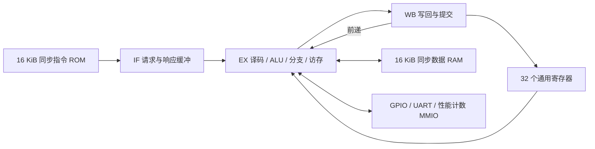

# 基于紫光同创 FPGA 的 RV32I 三级流水处理器与性能分析平台

版本：2026-10-28，离线验收候选版。本文描述已经实现的设计；尚未完成的实板测评单独列出。

## 作品目标与赛题对应

面向全国大学生嵌入式芯片与系统设计竞赛 2026 FPGA 创新设计赛道、紫光同创选题一。设计采用 SystemVerilog，实现 RV32I 整数处理器、三级流水线、片上同步存储器、UART/GPIO 及性能计数器。目标器件为 PGL25G/-6/MBG324。

| 赛题内容 | 当前交付内容 | 验证边界 |
|---|---|---|
| RV32I 处理单元 | 算术逻辑、立即数、访存、分支、跳转、FENCE | 定向及固定种子随机差分仿真；不是官方架构认证 |
| 不少于三级流水 | IF/EX/WB，前递、访存等待、控制转移清除 | 逐条提交检查及同步存储延迟压力测试 |
| UART/GPIO | 发送 UART、8 位 GPIO，板级连接 4 个 LED | SoC、真实 C 固件及板级顶层仿真；当前硬件输出仍待恢复 |
| CoreMark | 裸机移植、软件乘除法、双镜像、CRC 检查 | 单次迭代正确性仿真已通过；没有有效实板分数 |
| 性能分析 | 64 位周期/提交计数、资源及时序报告、仿真波形 | CPU 执行 CoreMark 的硬件 ILA 波形仍待采集 |

## 系统结构



取指端采用 valid/ready 接受请求，rvalid 返回已注册的数据。发生跳转时，已经接受的错误路径取指会被排空并丢弃，不能直接取消外部尚未完成的请求。EX 等待数据访存完成时保持请求稳定，WB 完成一次后清空，避免同一条指令被重复计数。WB 到 EX 前递处理相邻的数据依赖。

提交接口输出 PC、原始指令、目标寄存器和写回数据，离线差分验证直接比较这些接口，不以“最后亮灯”代替指令验证。

## 地址空间与运行环境

| 地址 | 功能 |
|---|---|
| 指令地址 0x00000000–0x00003fff | 16 KiB 指令 ROM |
| 数据地址 0x00000000–0x00003fff | 数据 RAM 低地址别名 |
| 0x20000000–0x20003fff | 指令 ROM 的只读数据访问别名，用于启动复制 |
| 0x40000000–0x40003fff | 数据 RAM 的链接地址别名 |
| 0x10000000 | GPIO 输出/读回 |
| 0x10000004 | UART 发送，读 bit0 为 ready |
| 0x10000010 / 14 | 周期计数低/高 32 位 |
| 0x10000018 / 1c | 提交指令计数低/高 32 位 |
| 0x10000020 | 配置的时钟频率，不能当作主频实测值 |

软件采用 RV32I/ILP32、裸机、无 libc。start.S 设置栈、从 ROM 别名复制 .data、清零 .bss，再进入 C main。链接脚本保留 1 KiB 栈空间，并检查数据区与栈是否重叠。CoreMark 的乘除法由软件例程完成，不依赖 M 扩展。

## 已实现的停机策略与限制

EBREAK 正常停机；非法指令和未对齐访问触发 trap 停机，禁止故障指令产生访存或寄存器写回副作用。ECALL 当前也进入 trap 停机，没有 mcause/mepc/mtvec、MRET 或可恢复的中断入口。因此不能宣称已经实现完整异常/中断或完整特权架构。

FENCE 在无 Cache、单核、按顺序完成数据事务的当前系统中按 NOP 执行。未实现 CSR、M/C 扩展、Cache、BTB、DDR 控制器和 AI 加速器。这些限制不是本轮离线验收的通过项。

## 离线复现

依赖：Python 3.10+、PowerShell、Icarus Verilog。优先使用工作区父目录 tools/iverilog/bin，否则从 PATH 查找 iverilog/vvp。工具运行时与 PDS 许可证不随交付包分发。

在 fpga_riscv_starter 目录执行：

```powershell
python scripts/validate_offline.py
python scripts/build_delivery.py --label 2026-10-28
```

需要重编译裸机软件时，使用 `scripts/build_firmware.ps1 -App all -Rebuild`，本机现有构建入口依赖 WSL 中的 RISC-V GCC。离线验收默认校验并使用已有镜像，不声称每次都重新调用编译器。

完整结果见 build/offline_validation/summary.json；每项结果与源码 SHA256 绑定。打包脚本拒绝失败验收、源码已变化、固件不一致或损坏的发布包。

## 尚待实板补齐

恢复可靠输出与复位重复运行；取得不少于 10 秒的 CoreMark 实测报告；采集 CPU 关键算法的硬件 ILA 波形；据实填入性能分析报告。现有单次迭代仿真和诊断波形不能代替这些数据。Flash 冷启动未验收，不作为本候选版已完成能力。
