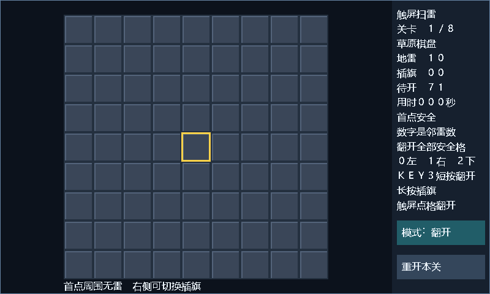

# 演示操作指南

作品：RISC-V 处理器与触屏扫雷系统  
平台：正点原子 ATK-L50，PGL25G-6/MBG324

## 1. 环境与镜像

硬件使用 ATK-L50 开发板、JTAG 下载器、USB 串口和 800×480 RGB LCD，触摸控制器为 GT9147。LCD 对应 Bank3 电压配置为 3.3 V，使用项目 `Vcc33` 引脚约束。接线和供电按开发板及屏幕手册完成。

| 演示内容 | 发布目录 | 位流 / 掩码 | 工作频率 |
|---|---|---|---|
| CoreMark | [coremark](../releases/2026-11-04/coremark/) | `atk_l50_top.sbit` / `atk_l50_top.smsk` | CPU 25 MHz |
| 中文触屏扫雷 | [mine](../releases/2026-11-04/mine/) | `atk_l50_mine.sbit` / `atk_l50_mine.smsk` | 系统 50 MHz，像素 25 MHz |

两套镜像分别加载，文件 SHA256 以各自 `manifest.json` 为准。公开发布目录可直接用于 PDS Programmer；命令行下载脚本读取重新构建生成的 `build/board_release/<target>/<app>`，不会自动使用 `releases` 中的文件。

软件环境：Pango Design Suite 2022.2-SP4.2、PowerShell、Python、Icarus Verilog，以及 WSL Ubuntu 中的 RISC-V GCC 14.2.0。仅演示已有镜像时无需重新编译固件。

## 2. 加载已发布镜像

1. 在 PDS Programmer 中连接 JTAG，核对器件 PGL25G，JTAG ID 为 `0x00511899`。
2. 选择所需镜像的 `.sbit` 和同目录 `.smsk`，使用 SRAM 配置流程与掩码回读校验。
3. CoreMark 演示先启动下一节的 UART 采集，再执行下载；已加载镜像可通过板级复位重新运行。
4. 检查下载 DONE、回读和程序运行结果。SRAM 配置断电后失效，演示流程不写入 Flash。

## 3. CoreMark 跑分

所有命令在仓库根目录执行。将串口示例 `COM3` 替换为实际端口，在独立 PowerShell 终端打开采集：

```powershell
$SerialPort = 'COM3'
./scripts/capture_uart.ps1 -Port $SerialPort -TimeoutSeconds 180 -OutputDir build/capture_run -CompletionMarker 'Correct operation validated. See readme.txt for run and reporting rules.' -CompleteLine
```

出现 `UART_CAPTURE_READY` 后下载或复位性能镜像。串口格式为 115200、8N1；脚本不发送数据、不切换 DTR/RTS，也不主动复位。等待报告包含完整 validated 行，随后复核：

```powershell
python scripts/coremark_score.py --capture build/capture_run/capture.txt --clock-hz 25000000 --lut-count 11864 --evidence-kind BoardCapture --output-dir build/score_run
```

预期结果以[归档评分](evidence/2026-11-04/coremark/score.json)为参照：2000 次迭代、398164697 ticks、15.92658788 秒、125.57618 CoreMark、5.023047 CoreMark/MHz。核对 seedcrc `e9f5`，list/matrix/state CRC `e714/1fd7/8e3a`，最终 CRC `4983`。

必须检查评分 JSON 的 `verdict=PASS` 和 `publishable=true`；仅命令正常退出不足以证明计时合格。重新实现的镜像若资源或频率改变，需使用对应真实数值重新评分并独立归档。

## 4. 触屏扫雷操作

加载扫雷镜像后，屏幕左侧显示 9×9 棋盘，右侧显示关卡、雷数和状态。目标是打开所有非雷格；数字表示相邻八格中的雷数。第一次打开的格子及相邻区域安全，空白区域自动展开。灰色障碍格不能操作。

| 操作方式 | 动作 |
|---|---|
| 触摸棋盘格 | 默认开格；插旗模式下切换旗标 |
| 右侧上按钮 | 切换开格/插旗模式 |
| 右侧下按钮 | 游戏中重开本关；结束后重开或进入下一关 |
| KEY0 / KEY1 | 光标左移 / 右移，边缘循环 |
| KEY2 | 光标下移，到底部后回到顶部 |
| KEY3 短按后释放 | 打开光标所在格 |
| KEY3 按住约 0.4 秒后释放 | 插旗或取消旗标 |

KEY3 长按阈值为 18 帧。LCD 像素时钟 25 MHz，总时序 1056×525，实际刷新率约 45.09 Hz。

踩雷后显示地雷、触雷位置和错旗；胜利或失败画面保持显示。松开已有按键/触摸后，再按任意 KEY 或点右下按钮继续：失败重开同一关，胜利进入下一关，第 8 关通过后回到第 1 关。

| 关卡 | 雷数 | 可用格数 | 地形 |
|---:|---:|---:|---|
| 1 | 10 | 81 | 开放棋盘 |
| 2 | 12 | 65 | 四角障碍 |
| 3 | 14 | 77 | 中列分段障碍 |
| 4 | 16 | 73 | 上下成组障碍 |
| 5 | 18 | 81 | 开放棋盘 |
| 6 | 20 | 65 | 四角障碍 |
| 7 | 22 | 77 | 中列分段障碍 |
| 8 | 24 | 73 | 上下成组障碍 |



图为渲染 RTL 生成的预览。实物操作记录见[验收文件](evidence/2026-11-04/mine/operator_acceptance.json)。

## 5. 从源码构建

性能固件使用扩展指令与 8 KiB RAM；应用固件使用 RV32I 与 16 KiB RAM。分别执行：

```powershell
./scripts/build_firmware.ps1 -App coremark -Isa rv32i_zba_zbb_zmmul -Opt '-O3' -Relax 1 -ExtraCflags '-flto -finline-limit=1000' -RamBytes 8192 -Rebuild
./scripts/build_firmware.ps1 -App mine -Isa rv32i -Opt '-O2' -RamBytes 16384 -Rebuild
```

`-App mine` 同时构建板用和仿真用固件。仿真验证：

```powershell
python scripts/run_isa_checks.py --zmmul --bitmanip --dual --mul-cycles 2 --decode-pipeline 0
python scripts/run_board_clock_checks.py
python scripts/run_mine_checks.py
```

配置本机 PDS 安装路径、许可证和纯 ASCII 构建目录。以下路径仅为配置示例：

```powershell
$PdsInstall = 'C:\tools\PDS_2022.2-SP4.2-ads'
$PdsWork = 'C:\fpga\riscv_build'
$PdsLicense = 'C:\fpga\licenses\pds.lic'
./scripts/run_pds.ps1 -Target cpu -FirmwareApp coremark -ConstraintProfile Vcc33 -Stage Bitstream -PdsRoot $PdsInstall -WorkRoot $PdsWork -LicenseFile $PdsLicense
./scripts/run_pds.ps1 -Target mine -FirmwareApp mine -ConstraintProfile Vcc33 -Stage Bitstream -PdsRoot $PdsInstall -WorkRoot $PdsWork -LicenseFile $PdsLicense
```

构建完成后分别检查 `build/board_release/cpu/coremark` 与 `build/board_release/mine/mine` 的产物身份、资源和时序。布局布线可能产生不同位流，重新生成的文件按新哈希记录。

```powershell
# 仅检查本地发布包，不访问硬件
./scripts/program_sram.ps1 -Target cpu -FirmwareApp coremark -CheckPackageOnly
./scripts/program_sram.ps1 -Target mine -FirmwareApp mine -CheckPackageOnly

# 按演示内容选一条命令；性能镜像先打开 UART 采集
./scripts/program_sram.ps1 -Target cpu -FirmwareApp coremark
./scripts/program_sram.ps1 -Target mine -FirmwareApp mine
```

## 6. 演示记录

推荐演示顺序为：说明双镜像配置，展示完整 CoreMark 报告与评分，再加载扫雷展示开格、插旗、按键和结束画面。保留原始 UART、下载回读日志、位流哈希与实物操作录像；性能数据与镜像身份核对方法见[性能分析报告](性能分析报告.md)和[提交材料清单](提交材料清单.md)。
